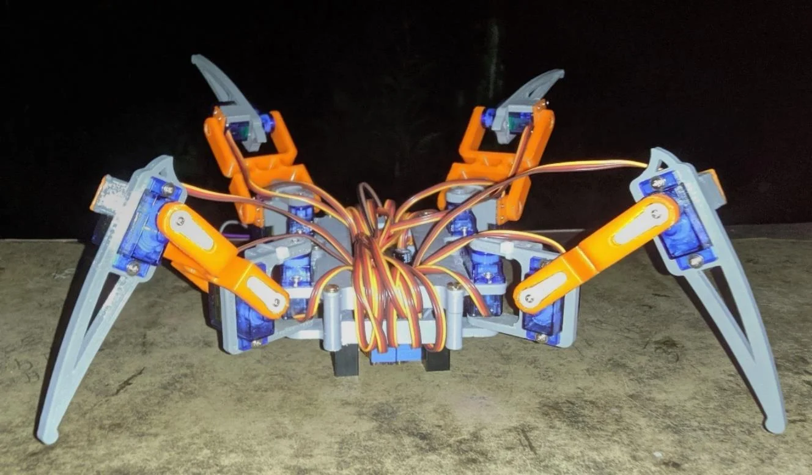

# Quadruped robot capstone

An engineering project documented in a 35-page report, with Python modules for servo control, image-based navigation decisions, and environmental sensor publishing.



Actual project photograph reproduced from Figure 8.1, printed page 26 (PDF page 32).

[Read the project report](src/Ashwin%20BE%20Project%20Report.pdf)

## Report and current source

The report describes a quadruped with Raspberry Pi, 12 servos, camera/ultrasonic obstacle detection, manual movement, video streaming, and environmental monitoring. The checked-in source implements part of that system:

| File | Available implementation | Current limitation |
| --- | --- | --- |
| `src/locomotion.py` | PCA9685 control, leg calibration, initial stance, forward gait | No backward or turning functions; hardware initializes at import |
| `src/navigation.py` | Camera frames, filtering, Canny edges, scanned regions, printed direction decisions | Decisions are not connected to locomotion; no ultrasonic control |
| `src/manual_control.py` | Linux terminal key capture | Imports missing backward/turn functions and cannot currently start |
| `src/iot_monitor.py` | DHT11 polling and ThingSpeak publishing | Requires hardware and user-provided channel credentials |

No `stream_client.py` exists in this snapshot. The report's video-streaming workflow is separate from the checked-in modules. The report supports the engineering context, but it does not establish that this partial source is a turnkey robot.

## Setup and review

Review the report's wiring, voltage rails, and calibration before any physical execution. These modules target Raspberry Pi/Linux, not a Windows workstation. The project uses legacy Pi camera and hardware libraries; validate compatibility with your hardware and OS. `locomotion.py` imports `Adafruit_PCA9685`, so the dependency uses the matching legacy package rather than the separate CircuitPython driver.

```sh
python -m pip install -r requirements.txt
# Camera-only navigation decisions; does not actuate the robot:
python src/navigation.py
```

Do not run manual mode until the missing movement routines are implemented and validated on the robot.

## Roadmap

- Implement and validate backward and turning gaits.
- Connect navigation decisions to the locomotion module.
- Add a hardware demo video.

## Academic context

Final-year project for the Bachelor of Engineering (BE), Electronics and Communication Engineering with CS, SDM Institute of Technology, Visvesvaraya Technological University (VTU), 2021. The report is the primary project documentation.

## License

Source code is released under the [MIT License](LICENSE).
