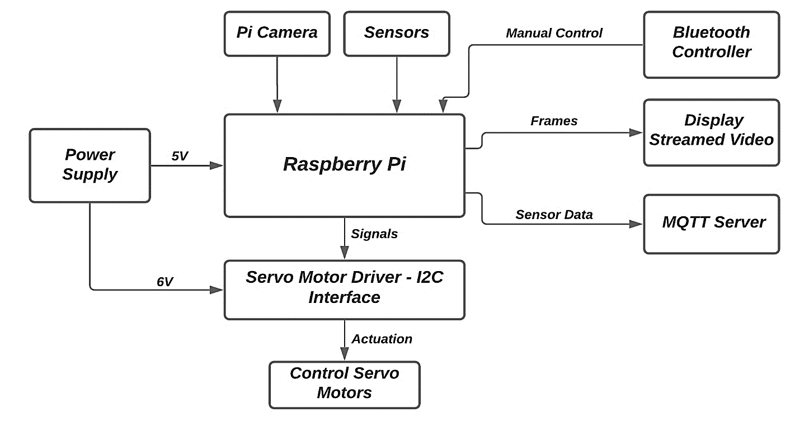
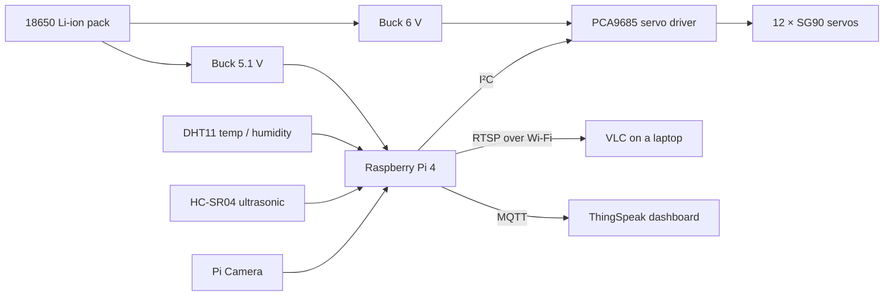
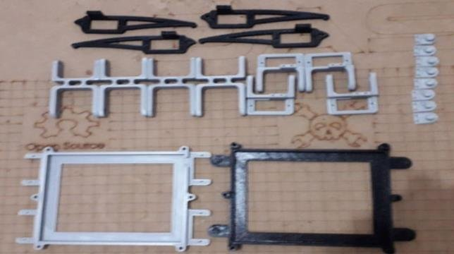
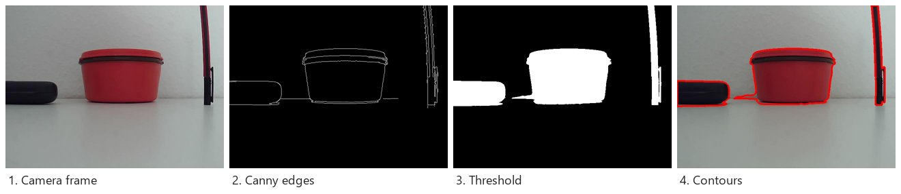
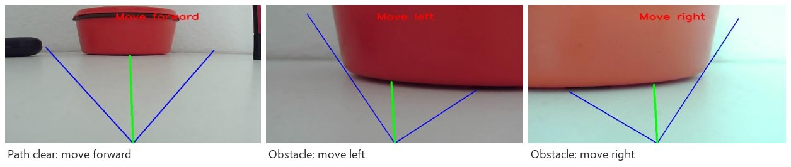
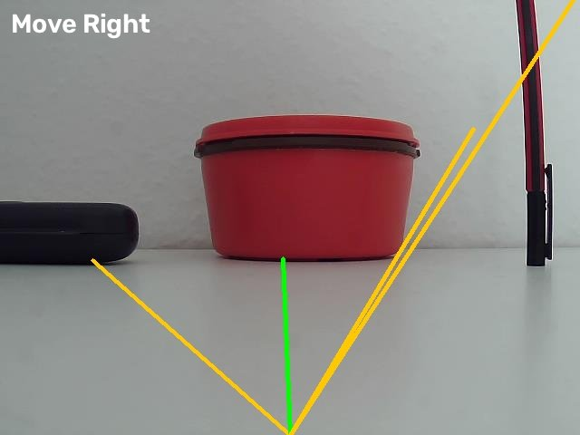
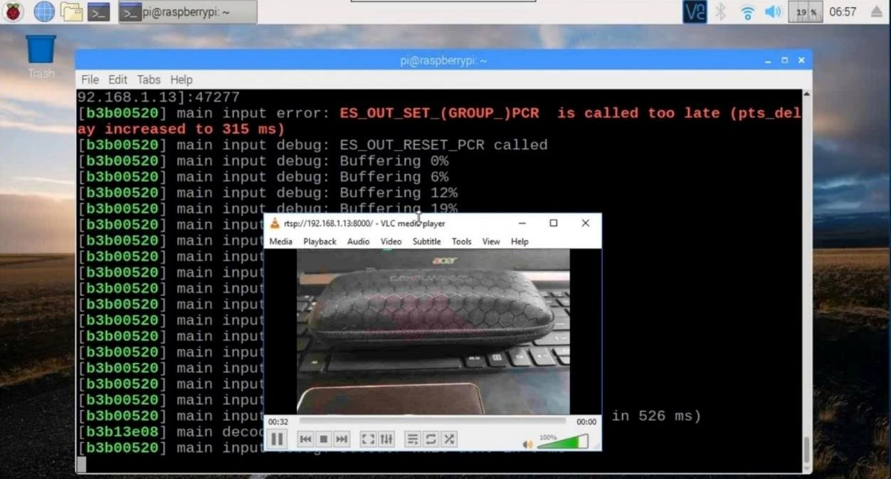
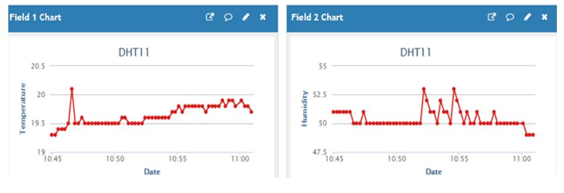

<picture>
  <source media="(prefers-color-scheme: dark)" srcset="assets/banner-dark.svg">
  
</picture>

<p align="center">
  <a href="https://github.com/ashwinpr15/Autonomous-Quadruped-Robot-for-Vision-Based-Navigation-and-IoT-Monitoring/actions/workflows/ci.yml"></a>
  
  
  <a href="LICENSE"></a>
</p>

My final-year engineering project (BE, Electronics & Communication Engineering with CS, 2021): a four-legged spider robot that walks with a creep gait, looks for obstacles with a Pi Camera, streams what it sees to a laptop, and reports temperature and humidity to a cloud dashboard.

**[📄 Read the full 35-page project report](src/Ashwin%20BE%20Project%20Report.pdf)**

<p align="center">
  
  <br><sub>The assembled robot (report, Fig 8.1).</sub>
</p>

## How it fits together

<p align="center"></p>

A Raspberry Pi 4 is the brain. It reads the camera and sensors, decides where to go, and sends servo positions over I²C to a PCA9685 driver that moves the twelve leg servos. Two buck converters split one battery pack into 5.1 V for the Pi and 6 V for the servos, so the motors can't brown out the computer.



## Parts list

| Part | What it does |
|---|---|
| Raspberry Pi 4 (2 GB) | Runs everything: vision, gait control, streaming and IoT |
| Pi Camera (5 MP, 1080p30) | Front-facing camera for obstacle detection and video |
| 12 × SG90 servos (180°) | Three joints per leg; 1.5 kg·cm at 6 V |
| PCA9685 16-channel PWM driver | Drives all 12 servos over I²C using just two Pi pins |
| 2 × LM2596 buck converters | 5.1 V for the Pi, 6 V for the servo rail |
| ICR18650 Li-ion cells (3.7 V) | Battery pack |
| HC-SR04 ultrasonic sensor | Backup obstacle sensing, 2–400 cm |
| DHT11 sensor | Temperature (0–50 °C) and humidity (20–90 %) |
| 3D-printed chassis and legs | Spider-style quadruped frame |

<p align="center"><br><sub>The 3D-printed parts before assembly (Fig 4.2).</sub></p>

### Wiring

| From | To |
|---|---|
| PCA9685 SDA | Pi GPIO 2 (SDA) |
| PCA9685 SCL | Pi GPIO 3 (SCL) |
| PCA9685 VCC / GND | Pi 5 V / GND (logic power) |
| PCA9685 V+ | 6 V buck converter (servo power) |
| Servo channels 0–2 / 3–5 / 6–8 / 9–11 | Legs 1 / 2 / 3 / 4 |
| DHT11 data | Pi GPIO 4 |

## Walking: the creep gait

The robot uses a **creep gait**: only one leg lifts at a time, so three feet always form a stable triangle under the centre of gravity. It's slow, but it's the quietest and most stable gait: the one predators use when stalking prey. Each leg swings between a *parallel* position (90°) and a *lateral* position (140° front, 40° back), and the body shifts forward while the other three legs push.

`src/locomotion.py` holds the calibrated angles and per-leg offsets from the report, moves each servo one degree at a time for smooth motion, and runs legs in parallel threads with a lock around the I²C bus.

## Seeing obstacles

<p align="center"></p>

1. **Clean up the frame.** A bilateral filter removes noise but keeps edges sharp.
2. **Find edges.** Canny edge detection (it beat Sobel, Prewitt and Laplacian in the report's comparison, Table 6.1).
3. **Scan from the bottom up.** Every 5th column is scanned upward until the first edge, giving the nearest obstacle in that column.
4. **Split into left, centre and right** and average each chunk.
5. **Decide.** If the centre obstacle is close (below row 250 of a 640×480 frame), turn toward whichever side is most open; otherwise keep walking forward.

<p align="center"><br><sub>Decisions from the robot's camera during testing (Fig 6.6).</sub></p>

### Try it without the robot

The navigation code runs on any computer with a still image. A frame from the robot's camera is included:

```sh
pip install -r requirements-dev.txt
python src/navigation.py --image docs/images/sample-frame.png --out navigation-output.jpg
```

```
Action: Move Right  (annotated image saved to navigation-output.jpg)
```

<p align="center"></p>

## Streaming and sensor monitoring

The Pi streams its camera to any laptop on the same Wi-Fi with VLC:

```sh
# on the Raspberry Pi
raspivid -o - -t 0 -n -w 600 -h 400 -fps 12 | cvlc -vvv stream:///dev/stdin --sout '#rtp{sdp=rtsp://:8554/}' :demux=h264
# then open this in VLC on the laptop
rtsp://<raspberry-pi-ip>:8554/
```

`src/iot_monitor.py` reads the DHT11 every 15 seconds and posts temperature and humidity to a ThingSpeak channel:

<p align="center">
  
  
</p>

## Running it on the robot

```sh
pip install -r requirements.txt

python src/locomotion.py        # stand up, then take one creep-gait cycle
python src/manual_control.py    # keyboard control: W walks forward, X exits
python src/navigation.py        # live camera obstacle avoidance (ESC to quit)

export THINGSPEAK_CHANNEL_ID=1234567
export THINGSPEAK_WRITE_KEY=XXXXXXXXXXXXXXXX
python src/iot_monitor.py       # DHT11 -> ThingSpeak every 15 s
```

Check the wiring and servo calibration before powering the servos; the angles are tuned for this specific build. The scripts target Raspberry Pi OS and the legacy `Adafruit_PCA9685` and `Adafruit_DHT` libraries.

## What's in this repo, and what isn't

| Feature | In the report | In this code |
|---|:---:|:---:|
| Creep gait: stand up and walk forward | ✅ | ✅ |
| Backward walking and left/right turns | ✅ | Not yet |
| Camera obstacle detection and direction decision | ✅ | ✅ (prints the decision) |
| Driving the legs from the camera decision (auto mode) | ✅ | Not yet |
| Ultrasonic obstacle detection | ✅ | Not yet |
| Video streaming to VLC | ✅ | ✅ (shell command above) |
| DHT11 → ThingSpeak monitoring | ✅ | ✅ |

The report covers the complete robot; this repository has part of its code, so a few features are documented in the report but not here yet.

## Project layout

```
├── src/
│   ├── locomotion.py        # servo control, calibration and the creep gait
│   ├── navigation.py        # camera -> edges -> left / forward / right
│   ├── manual_control.py    # keyboard control (W to walk forward)
│   ├── iot_monitor.py       # DHT11 readings to ThingSpeak
│   └── Ashwin BE Project Report.pdf
├── tests/                   # offline tests (no Pi, camera or servos needed)
├── docs/images/             # figures from the report and the demo output
├── requirements.txt         # libraries for the Raspberry Pi
└── requirements-dev.txt     # libraries for running tests and the image demo on a laptop
```

## Ideas for a next version

These come from the report's future-scope chapter:

- A **trot gait** (two legs at a time) for faster, dynamically stable walking
- An **accelerometer or ground-facing proximity sensors** to give the robot a sense of depth and terrain
- A **CNN-based obstacle detector**, so detection works on busy backgrounds where plain edge detection struggles
- **Closing the loop:** feeding the camera's decision straight into the gait for a fully autonomous mode

## License

Code is released under the [MIT License](LICENSE). The project report and its figures are my own work from the BE programme at SDM Institute of Technology (Visvesvaraya Technological University).
